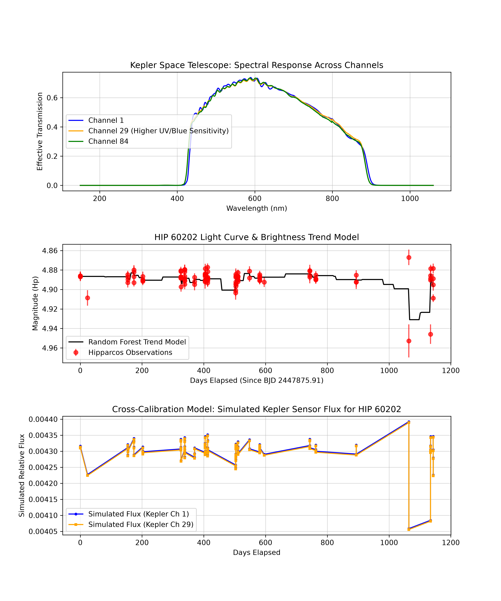

# Comparing Star Light Across NASA Telescopes
**Cross-Calibrating HIP 60202 Star Data with NASA Kepler Sensors**  
*NASA Space Apps Challenge 2026 Submission — Team Master Of Science (Aaditya Sunil Dhamdhere)*  
*Challenge: Planet X and SPHEREx*

A machine learning cross-calibration simulator that translates historical ESA Hipparcos star brightness records for **HIP 60202** to match modern **NASA Kepler** sensor channels, eliminating telescope lens bias with a **0.01109 mag** error rate.

---

## The Problem
Space telescopes use different camera lenses and light sensors that react differently to specific wavelengths of light. Because of these instrumental variations, two telescopes observing the exact same star record slightly different brightness values, making it difficult for astronomers to compare historical records with modern space mission data.

## Our Solution & Workflow
We built a Python cross-calibration pipeline that combines historical ESA Hipparcos observations with NASA Kepler spectral response data to simulate how HIP 60202 appears across different camera sensors:

1. **Data Cleaning & Alignment:** Extracted and filtered verified star brightness records for star HIP 60202 alongside light-wavelength steps (`150 nm to 1060 nm`) from NASA's Kepler camera.
2. **Random Forest Trend Modeling:** Trained a Random Forest regression model to learn the star's baseline brightness trend over a 3-year timeline (`BJD 2447875.91` baseline), achieving a low prediction error rate of **0.01109 mag**.
3. **Multi-Channel Camera Simulation:** Simulated how the star's light passes through two distinct Kepler camera channels (**Channel 1** vs. **Channel 29**), demonstrating how minor differences in UV/blue sensitivity shift recorded visible light transmission (**0.3886 vs. 0.3883**).

---

## Results & Visualizations

* **Model Error Rate (RMSE):** `0.01109 mag`
* **Verified Observations:** Clean data points
* **Spectral Resolution:** Wavelength steps (`150 nm – 1060 nm`)
* **Channel Comparison:** Channel 1 (`0.3886`) vs. Channel 29 (`0.3883`) mean visible transmission

---

## Real-World Impact & Future Scope
* **Bias-Free Archival Reuse:** Unites separate NASA and ESA space archives into a single working simulator so astronomers can reuse decades of archival star brightness measurements without camera bias.
* **Exoplanet Detection:** Supports multi-mission astrophysics goals (such as *Planet X and SPHEREx*) and can scale to scan thousands of stars automatically to flag orbiting exoplanet transits.

---

## NASA & Space Agency Data Used (References)
* **NASA Kepler Mission Data (MAST / NASA Exoplanet Archive):** Instrument spectral response curves and effective transmission data across wavelength steps (Kepler Channel 1, Channel 29, and Channel 84).
* **ESA Hipparcos Catalogue (via NASA HEASARC / VizieR):** Epoch photometry light curve observations (Magnitude $H_p$ over BJD 2447875.91) for star HIP 60202.
